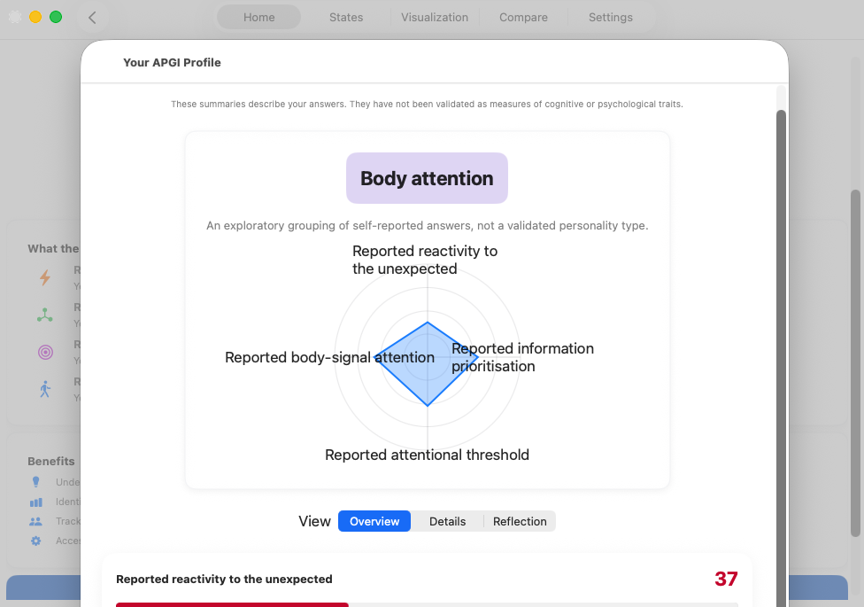

# APGI Explorer

A macOS self-report questionnaire app that helps users reflect on how they describe their own cognitive and emotional processing styles, using the APGI framework's vocabulary. Built with SwiftUI for macOS.



*The results screen. Summaries describe the answers you gave; they are exploratory, have not been validated as measures of cognitive or psychological traits, and are not a diagnosis.*

> **Reading this document.** Every section below keeps the points of the original overview, but each is stated as the code does it today. Where an original point describes something that is not built, it says so ("not implemented", "planned") rather than being dropped.

## Contents

1. [App Overview](#1-app-overview)
2. [Core Assessment System](#2-core-assessment-system)
3. [Technical Architecture](#3-technical-architecture)
4. [User Interface & Experience](#4-user-interface--experience)
5. [Platform-Specific Features (macOS)](#5-platform-specific-features-macos)
6. [Data Management & Export](#6-data-management--export)
7. [Settings & Customization](#7-settings--customization)
8. [Privacy & Data Security](#8-privacy--data-security)
9. [Research Mode, API & Verification](#9-research-mode-api--verification)
10. [Testing & Quality Assurance](#10-testing--quality-assurance)
11. [Development & Build Configuration](#11-development--build-configuration)
12. [API Reference & Documentation](#12-api-reference--documentation)
13. [Deployment & Distribution](#13-deployment--distribution)
14. [Contributing & Support](#14-contributing--support)
15. [License & Legal](#15-license--legal)
16. [Roadmap & Future Development](#16-roadmap--future-development)
17. [Additional Resources](#17-additional-resources)

---

## 1. App Overview

### Application Identity

- **App Name**: APGI-Explorer
- **Bundle Identifier**: `com.lesoto.APGI-Explorer`
- **Platform**: macOS (SwiftUI). The shipping target currently requires **macOS 26.3** and a compatible Xcode SDK; the earlier "macOS 12.0+" figure is no longer the deployment target.
- **Architecture**: Built with Xcode's standard architectures. A verified universal (arm64 + x86_64) distribution build has not been produced by CI.
- **Version Status**: Version 1.0, an **exploratory personal release**. Research mode and all paid products are disabled in this build.

### Core Purpose

APGI-Explorer implements an **exploratory self-report questionnaire**. It is not a validated psychological measure, a diagnostic instrument, a scientific model, or a source of population norms. It:

- Administers a 35-question questionnaire (a fixed item set; items are not selected adaptively)
- Summarises answers on four described groups (internal symbols ε, π, θₜ, β) plus three further item groups
- Places answers in one of 8 exploratory groupings, each with a descriptive name
- Provides interactive visualization and state exploration
- Generates reports and descriptive summaries of your own answers
- Offers a responsive experience with window-size constraints and managed windows

Personal mode uses the 35 bundled questions and stays local. `APGIScorer` is the local instrument scoring key. Items 7 and 9 are nominal choices and do not contribute to numeric averages. All 35 valid item responses are required for a result.

The app requests public release metadata from **https://api.apgiframework.com/v1/meta** on launch and from Settings → General → APGI API → Check connection. Requests contain no questionnaire answers or participant credentials. Network and HTTP errors appear in Settings; they do not interrupt personal mode. API metadata does not enable paid products or research participation in this release.

- Website: https://apgiframework.com
- API: https://api.apgiframework.com
- Source: https://github.com/apgiframework/APGI-Explorer
- Support: https://github.com/apgiframework/APGI-Explorer/issues
- Local instrument: `apgi-explorer-35`
- Analysis mode: `exploratory`, excluded from norms

---

## 2. Core Assessment System

### APGI Parameters

The app summarises answers on four described groups. The Greek symbols are internal identifiers; the app shows descriptive labels.

1. **ε, shown as "Reported reactivity to the unexpected"**: how strongly you report reacting to unexpected events and changes
2. **π, shown as "Reported information prioritisation"**: how you report prioritising different sources of information
3. **θₜ, shown as "Reported attentional threshold"**: how you report your attentional focus and awareness
4. **β, shown as "Reported body-signal attention"**: how much attention you report giving to bodily signals

These are descriptions of answers, not measurements of traits. The original construct names were retired from the interface so that no value is presented as a measured psychological quantity.

### Assessment Features

- **35 questions** across 7 item groups of five. They are not validated; the exploratory status is stated in the results screen.
- **Equal-weight scoring**: each group is the mean of its ordinal items on a 12.5, 37.5, 62.5, 87.5 display scale. There is no reliability weighting, no invented confidence interval, and no cross-group adjustment; changing one group's answers leaves the others unchanged.
- **Real-time progress tracking** with visual feedback during the questionnaire (no score is shown while answering)
- **Response validation**: unknown question IDs, responses outside 1–4 and incomplete item sets produce an explicit invalid result rather than a number
- **No confidence score**: the earlier "confidence scoring" of response patterns was removed because it was not supported by evidence

### Profile Types

The app places answers in one of 8 exploratory groupings. Each is described only as a pattern of responses and carries the note "An exploratory grouping of self-reported answers, not a validated personality type." Displayed names (with the internal identifier in parentheses):

1. **Reactivity and body attention** (`sensitiveIntegrator`)
2. **Information focus and attention** (`analyticalGuard`)
3. **Mixed responses** (`adaptiveBalancer`)
4. **Reactivity and open attention** (`openExplorer`)
5. **Lower reactivity and attention focus** (`contemplativeAnchor`)
6. **Body attention** (`somaticNavigator`)
7. **Information and attention focus** (`cognitiveArchitect`)
8. **Reactivity and interaction** (`dynamicResponder`)

The earlier personality-style names, strengths, challenges and per-grouping colour descriptions were removed from the interface; the personality names remain only as internal identifiers.

---

## 3. Technical Architecture

### SwiftUI Framework & Architecture

- **Primary Framework**: SwiftUI for declarative UI
- **Data Persistence**: Core Data with lightweight migration (the current model version adds the research `PendingEvent` outbox entity; the original version is unchanged)
- **State Management**: ObservableObject, @StateObject, @EnvironmentObject
- **Navigation**: TabView with five dedicated views
- **Window Management**: Multi-window support with minimum size constraints

### Key Components

- **APGIScorer** (in `Core/`): Instrument scoring key returning `Result<APGIProfile, ScoringError>`; equal-weight item means, no reliability weighting
- **ProfileManager**: Manages user profiles, comparisons, and data persistence
- **StateModel**: Handles roughly 50 illustrative psychological states and transitions (reference visuals, not self-report)
- **ThemeManager**: Theming with debounced changes
- **FileStorageManager**: Backup and export of profiles
- **WindowManager**: Window management with minimum sizes
- **ResearchExportManager**: Export system listing 13 formats (see section 6 for which are implemented)
- **AdvancedAnalyticsManager**: Local analytics helpers; the earlier unvalidated forecasts were removed
- **AccessibilityManager**: Accessibility support and monitoring
- **ScreenshotAutomation**: Screenshot generation for documentation (see `Screenshots.md`)
- **ContextualHelpManager**: In-app contextual help
- **PerformanceManager**: Performance monitoring
- **SecurityManager**: Keychain-backed storage of small secrets and values; it does not add an encryption layer to Core Data
- **CloudSyncManager**: **Not implemented.** There is no cloud synchronisation or cloud backup in this app.
- **Core (portable module)**: Foundation-only code compiled into the app and built separately by `Package.swift` for CI: API operation catalog and transport, canonical hashing, the research outbox, upload coordinator, credentials, and the research workflow. All research code is disabled in this build.

### Recent Technical Improvements

- **Window Management System**: Minimum size constraints for all window types
- **Animation Framework**: Transitions with timing functions
- **Theme Optimization**: Debouncing and animation contexts
- **Performance Enhancements**: Reduced visual artifacts
- **Contract and CI hardening**: Generated API catalog covering all 121 pinned operations, centralised score labels, language-policy checks, pinned secret scanning

### Data Models

- **ProfileEntity**: Core Data model for user profiles with score values
- **QuizSession**: Tracks assessment progress and responses (per-item value, previous value, sequence and monotonic latency)
- **PendingEvent**: Research upload outbox entity (inactive while research is disabled)
- **PsychologicalState**: roughly 50 illustrative states with metadata
- **ExportModels**: Export format definitions (JSON, CSV, PDF, PNG and others; see section 6)

### Project Structure

```text
APGI-Explorer/                      # repository root
├── APGI-Explorer/                  # app target sources
│   ├── APGI_ExplorerApp.swift      # App entry point
│   ├── MainTabView.swift           # Primary navigation
│   ├── ContentView.swift, QuizView.swift, ResultsView.swift, IntroView.swift
│   ├── PsychologicalStatesView.swift, PsychologicalStatesVisualizationView.swift
│   ├── ProfileComparisonView.swift, SettingsView.swift, ExportView.swift
│   ├── ProfileManager.swift, FileStorageManager.swift, QuizModel.swift
│   ├── AccessibilityManager.swift, AdvancedAnalyticsManager.swift, ContextualHelpManager.swift
│   ├── CrashReportingManager.swift, PerformanceManager.swift, ThemeManager.swift, WindowManager.swift
│   ├── Screenshot*.swift           # Screenshot automation
│   ├── Core/                       # Portable, Foundation-only code (APGIScorer, APGIProfile, transport, outbox, research workflow); also built by Package.swift
│   ├── Model/                      # Core Data classes (ProfileEntity, QuizSession)
│   ├── Services/                   # KeychainManager, SecurityManager, StoreManager, SpotlightManager,
│   │   │                           #   LocalizationManager, NotificationManager, ResearchExportManager,
│   │   │                           #   APGIAPIClient, ExplorerAPIStatus
│   │   └── Research/               # Core Data outbox store, Keychain stores, research model and views
│   ├── SettingsViews/              # General, Appearance, Charts, DataPrivacy, Advanced settings
│   ├── APGIExplorer.xcdatamodeld/  # Core Data model (two versions)
│   ├── Assets.xcassets/
│   ├── Info.plist, PrivacyInfo.xcprivacy, APGI-Explorer.entitlements
├── APGI-ExplorerTests/             # XCTest target (unit, contract and native research tests)
├── APGI-ExplorerUITests/           # UI test source (not registered as a target; CI does not run it)
├── APGI-Explorer-iOS/              # iOS app entry and privacy manifest (not a shipping target)
├── Tests/ExplorerCoreTests/        # Portable Swift tests run by `swift test`
├── Package.swift                   # Builds the portable Core on Linux for CI
├── contracts/                      # Pinned OpenAPI snapshots, identifiers, instrument pin, release hashes
├── scripts/                        # API generator, contract gates, language policy, secret scan
├── fastlane/Fastfile               # Build automation
├── docs/                           # Audit, runtime verification, compatibility entry, images
└── .github/workflows/              # ci.yml, swift.yml, nightly.yml, release.yml
```

Localization: `LocalizationManager` is present, but there are no translated `.lproj` resources in this repository. Store metadata and interface text are English.

---

## 4. User Interface & Experience

### Main Navigation Structure

The app uses a TabView with 5 main sections:

1. **Home** (`ContentView`): dashboard and assessment access
2. **States** (`PsychologicalStatesView`): interactive state exploration
3. **Visualization** (`PsychologicalStatesVisualizationView`): charts and graphs
4. **Compare** (`ProfileComparisonView`): profile comparison tools
5. **Settings** (`SettingsView`): app configuration

### Key Views & Features

- **QuizView**: Interactive assessment with progress tracking and handoff support (Handoff carries a session ID only)
- **ResultsView**: Profile results with descriptive summaries and a radar chart (see the image above)
- **EnhancedProfileChart**: Radar charts with customization options
- **OnboardingView**: Interactive tutorial with transitions
- **ScreenshotAutomation**: Screenshot generation for documentation

### UI/UX Enhancements

- **Responsive Window Management**: Windows have minimum size constraints (main 1000×700, state explorer 1200×800, comparison 1000×700, settings 600×500)
- **Smooth Animations**: Transitions with opacity and scale effects
- **Theme System**: Theme switching with animations and debouncing
- **Visual Polish**: Reduced artifacts during theme transitions
- **Performance**: Rendering tuned for interactions; no response-time figure is verified by CI
- **Advanced Accessibility**: VoiceOver labels, Dynamic Type and keyboard navigation in the main views
- **Contextual Help**: In-app help with contextual guidance
- **Screenshot Automation**: Documentation and testing screenshots
- **Adaptive Layout System**: Responsive layout for various window sizes
- **Loading Overlays**: Loading states and transitions

### Accessibility & UX

- VoiceOver labels on the main interactive views; a full accessibility audit has not been run
- Dynamic Type support for scalable text
- Keyboard navigation with shortcuts
- Dark mode support with system integration
- Responsive design for various window sizes
- WCAG 2.1 AA is a goal, not a verified claim

---

## 5. Platform-Specific Features (macOS)

### Native macOS Integration

- **Menu Bar Integration**: Quick access to key features and settings
- **Window Management**: Multiple windows with cascade, tile, and side-by-side arrangements
- **Keyboard Navigation**: Menu shortcuts including ⌘1, ⌘2 (tab switching), ⌘, (Settings), ⌘N, ⇧⌘N, ⇧⌘I, ⌘E, ⌥⌘E, ⇧⌘B and ⌘D
- **File Integration**: Import and export through user-selected files (the app is sandboxed and no longer has blanket Downloads or Pictures access)
- **System Notifications**: Native notification support; permission is requested only from Settings, never at launch

### Handoff & Continuity

- **Handoff Support**: Handoff carries only a **session ID**. Continuing an assessment on another device is **not** supported because answers are not transferred.
- **User Activity**: State preservation for app switching; the resumable draft stays local
- **Universal Links**: **Not implemented.** No associated-domains deep linking is configured.

### System Services

- **Share Sheet Integration**: Native macOS sharing for exports
- **Services Menu**: **Not implemented.**
- **Spotlight Integration**: **Intentionally removed.** Scores are never indexed in Spotlight, and any legacy entries written by older versions are purged at launch.

---

## 6. Data Management & Export

### Core Data Integration

- **PersistenceController**: Shared Core Data stack with lightweight automatic migration
- **Profile Storage**: Local storage with optional backup automation
- **Data Integrity**: Validation and error-recovery mechanisms
- **Performance**: Lazy loading and efficient data structures

Answer values, changes, sequence numbers and monotonic latencies are stored in local Core Data `QuizSession.jsonData`. UserDefaults retains the resumable draft. Completed histories remain local. Saved aggregate results are displayed directly, without fabricating answers; older aggregate-only profiles cannot recover missing item histories.

### Export Capabilities

- **JSON**: Profile data with metadata
- **CSV**: Tabular data for spreadsheet analysis
- **PDF**: Formatted report (real PDF output)
- **PNG**: Chart exports for sharing
- **Research Formats**: R (written as a `.R` script, not a binary `.RData`) and Excel (`.xlsx`) are written. **SPSS (`.sav`) and Stata (`.dta`) writers are not implemented**; they reject export and are not selectable.
- **Academic Formats**: APA and MLA formatted reports
- **Bibliography Formats**: BibTeX and EndNote citation formats
- **XML**: Structured data exchange format with escaped content
- **Export Manager**: One export system listing 13 formats
- **Research-Grade Outputs**: Descriptive, self-report-labelled exports. They carry the instrument ID and the exploratory, excluded-from-norms status.

### Backup System

- **Backups**: Configurable frequency: daily, weekly, monthly, never or manual
- **Retention Policies**: A retention-period validator exists, but no retention setting is exposed in the interface yet
- **Import/Export**: Settings backup and restore
- **Data Privacy**: All data stored locally. There is no separate app-level encryption layer; at-rest protection relies on the macOS sandbox and FileVault.

---

## 7. Settings & Customization

### Settings Categories

The app includes 9 settings categories:

1. **General**: Onboarding, behavior, profiles, API connection check, research entry (shown only when research is enabled)
2. **Appearance**: Themes, accessibility, colors, layout options
3. **Charts**: Chart styles, comparison modes, advanced options
4. **Privacy**: Analytics consent, crash-reporting consent, delete all data
5. **Export & Backup**: Format preferences, quality settings, backup automation
6. **Notifications**: Sound, badges, reminder preferences
7. **Window Management**: Arrangement preferences, layout options
8. **Psychological States**: Display modes, refresh settings, performance options
9. **Advanced**: Debug options, experimental features, system tools

### Settings Features

- **Real-time Configuration**: Settings changes apply without restart
- **Individual Reset Options**: Reset specific settings or delete all data
- **Import/Export Settings**: Backup and share configuration profiles
- **Validation Manager**: Automatic settings validation and error correction
- **Cloud Sync Settings**: **Not implemented** (there is no cloud sync)
- **Accessibility Settings**: Accessibility customization options
- **Debug Menu**: Debugging options and experimental features
- **Performance Monitoring**: Performance tracking and optimization
- **Error Reporting**: Error handling and user feedback

---

## 8. Privacy & Data Security

### Data Collection Principles

- **Local Storage**: Assessment data is stored locally on the device with Core Data. Personal answers are never included in network requests.
- **Optional Analytics**: Usage analytics are **off by default** and opt-in. The analytics service records to the local log; no analytics are sent over the network. The privacy manifest declares optional product-interaction data for analytics.
- **No Personal Data**: No personal information is collected without explicit consent. Research enrollment, which would collect pseudonymous answers, is disabled in this build.
- **Data Minimization**: Only data needed for app functionality is kept

### Privacy Features

- **Encryption**: There is no separate encryption layer over stored profiles; protection comes from the macOS sandbox and FileVault. Small secrets use the Keychain (device-local, `ThisDeviceOnly` for research credentials).
- **Granular Permissions**: Separate controls for analytics consent, crash-reporting consent and notifications
- **Data Export**: Export in standard formats (JSON, CSV, PDF)
- **Data Deletion**: "Delete All Data" in Settings removes local data
- **Privacy Controls**: Consent toggles and delete-all in Settings → Privacy; data retention periods are not yet configurable
- **Regulatory status**: No GDPR or CCPA compliance certification is claimed. Research consent (four versioned purposes served by the API) is built but disabled and awaits approved consent texts.

### Security Measures

- **App Sandbox**: Restricted system access; only user-selected file read/write and outgoing network connections are granted
- **Hardened Runtime**: Enabled
- **Code Signing**: Verified app integrity for distribution builds
- **Redirects refused**: API sessions reject HTTP redirects so credentials cannot be forwarded elsewhere
- **Secret scanning**: Checksum-pinned Gitleaks runs in CI with redacted output

---

## 9. Research Mode, API & Verification

Research mode and all five StoreKit products remain **disabled**. Paid products require both the remote Boolean `validation_results` and explicit approval compiled into the build (`ExplorerBuildApproval`, false). Research requires the build approval (false) **and** a server flag that also needs a configured study and battery and approved consent texts.

The research workflow is implemented and tested in the portable Core: it verifies the server item bank against a pinned hash, validates four-purpose consent texts, enrols, records answers in a durable outbox, uploads in order with exponential backoff, deletes local copies only after a `server_verified` acknowledgement, and shows only allow-listed scores. Tokens use a separate device-local Keychain store. The SwiftUI screens exist but have not been compiled or exercised in a native build. No personal or legacy data can enter a research upload path. See [the audit](docs/EXPLORER_AUDIT.md) for evidence, acceptance coverage and what remains.

### Build and verify

```sh
python3 scripts/generate_api_client.py --check
(cd scripts && python3 -m unittest test_api_generation test_language_policy)
python3 scripts/check_explorer_contracts.py
GITLEAKS="$(scripts/install_gitleaks.sh /tmp/gitleaks)" python3 scripts/test_secret_scan.py
swift test        # portable core only; does not build the macOS app
xcodebuild test -project APGI-Explorer.xcodeproj -scheme APGI-Explorer \
  -destination 'platform=macOS' -derivedDataPath DerivedData \
  CODE_SIGNING_ALLOWED=NO
```

`contracts/openapi-v1.json` is the deployed API snapshot fetched on October 27, 2026. `scripts/generate_api_client.py` reproducibly generates a catalog of **all 121 HTTP operations** in it: method, route, parameters, body requirement, authentication and successful status codes. Requests and responses are lossless JSON values; this is a transport catalog, not a strongly typed schema SDK. Authentication is an explicit argument. `contracts/explorer-research-v1.json` is an extract of the Explorer research operations from `apgi-api` and is generated into a separate catalog. Refresh snapshots deliberately and regenerate when the server contract changes. `APGI-Explorer/Core` holds the Foundation-only code that Xcode compiles into the app and `Package.swift` builds on Linux.

App Store publication, product delisting, branch protection, and retiring the former personal-account hosting require account-side changes; editing this repository does not perform them.

---

## 10. Testing & Quality Assurance

### Test Suite

- **Unit Tests**: Core functionality tests in the `APGI-ExplorerTests` XCTest target; coverage is reported by CI
- **UI Tests**: UI test source exists in `APGI-ExplorerUITests`, but it is not registered as a target and CI does not run it
- **Export Tests**: Export format validation, including rejection of unimplemented writers
- **Accessibility Tests**: Accessibility manager tests; no full compliance audit
- **Performance Tests**: Performance test cases exist; no response-time threshold is enforced
- **Security Tests**: Keychain and security manager tests, plus secret-scan regression tests
- **Integration Tests**: Contract gates, portable workflow tests (including offline and lost-acknowledgement upload against an in-memory API simulation), and native Core Data and Keychain tests that must be run on macOS

### Test Categories

1. **Core Assessment Tests**: Scorer invalid-input, completeness and subscale-independence tests
2. **Data Management Tests**: Core Data persistence and migration (native)
3. **Export Functionality Tests**: Export formats and edge cases
4. **UI/UX Tests**: Source present, not run in CI
5. **Performance Tests**: Test cases present
6. **Security Tests**: Keychain, credentials and secret scanning

### Quality Metrics

- **Code Coverage**: Collected in CI from the run's result bundle; no release threshold is currently enforced
- **Performance**: A response-time target is a goal, not a measured result
- **Accessibility**: WCAG 2.1 AA is a goal, not a verified claim
- **Security**: No third-party dependencies; credential scanning runs in CI. A dependency-vulnerability scan is not needed while there are no dependencies.

---

## 11. Development & Build Configuration

### Build Requirements

- **Xcode**: Current Xcode with the macOS 26.3 SDK or later (CI uses the latest stable Xcode)
- **macOS Target**: 26.3 minimum deployment target for the app
- **Swift Version**: The app target builds in Swift 5 language mode; the portable package needs Swift 6.2 (swift-tools-version 6.2)
- **Architecture**: Xcode standard architectures
- **Frameworks**: SwiftUI, Core Data, PDFKit, Charts, CoreSpotlight (purge only), AppKit, StoreKit (gated off). Earlier references to TabularData do not apply; it is not imported.

### Development Tools

- **SwiftFormat**: Configuration in `.swiftformat`
- **SwiftLint**: Configuration in `.swiftlint.yml`
- **Fastlane**: `fastlane/Fastfile`
- **GitHub Actions**: `ci.yml`, `swift.yml`, `nightly.yml`, `release.yml`
- **Screenshot Automation**: Documentation screenshots (see `Screenshots.md`)

### Build Configuration

- **Debug**: Logging, debug symbols and testing features
- **Release**: Optimized builds with hardened runtime and sandbox
- **Enterprise**: Not provided as a separate configuration
- **App Store**: Metadata in `AppStoreMetadata.json`; no App Store release has been published from this repository

### Dependencies

- **System Frameworks**: SwiftUI, Core Data, PDFKit, Charts, AppKit, StoreKit
- **Third-party**: None. The portable Core uses its own SHA-256 instead of an external crypto package.
- **Testing**: XCTest, plus Python unit tests for the generator, language policy and secret scan
- **Automation**: Screenshot and testing automation tools
- **Architecture**: Xcode standard architectures

---

## 12. API Reference & Documentation

### Core Classes

#### APGIScorer

```swift
// Local instrument scoring key; returns an explicit invalid result instead of a number
let scorer = APGIScorer()
switch scorer.calculateRobustScore(answers: answers) {   // answers: [Int: Int], items 1...35, values 1...4
case .success(let profile): print(profile.epsilon)
case .failure(let error): print(error)                    // .incomplete, .unknownItems, .invalidResponse
}
```

#### ProfileManager

```swift
// Profile management
let manager = ProfileManager()
await manager.loadProfiles()
let url = try manager.exportProfile(profile)
```

#### ResearchExportManager

```swift
// Export functionality (SPSS and Stata throw; they are not implemented)
let exportManager = ResearchExportManager.shared
let data = try exportManager.exportProfile(profileExport, format: .csv)
```

### Export Formats

| Format | Extension | Use Case | Features | Status |
| -------- | ----------- | ---------- | ---------- | ---------- |
| JSON | .json | Data interchange | Metadata, versioning | Implemented |
| CSV | .csv | Spreadsheet analysis | Tabular format | Implemented |
| PDF | .pdf | Reports & sharing | Charts, formatted report | Implemented |
| SPSS | .sav | Statistical analysis | Variable labels | Not implemented (rejects export) |
| Stata | .dta | Econometric analysis | Panel data | Not implemented (rejects export) |
| R Script | .R | Statistical computing | R data frame source with descriptions | Implemented as source text |
| Excel | .xlsx | Business analysis | Worksheets | Implemented |
| APA Report | .pdf | Academic papers | APA-style layout | Implemented |
| MLA Report | .pdf | Academic papers | MLA-style layout | Implemented |
| BibTeX | .bib | Academic writing | Bibliography management | Implemented |
| EndNote | .enw | Research management | Citation software | Implemented |
| XML | .xml | Data exchange | Structured, escaped | Implemented |
| PNG | .png | Visual sharing | Chart image | Implemented |

---

## 13. Deployment & Distribution

### Distribution Channels

- **Mac App Store**: Intended channel; metadata exists, but nothing has been published from this repository. Submission and delisting happen in App Store Connect.
- **Direct Download**: Notarized build via `build_and_notarize.sh` (see below)
- **TestFlight**: Possible through App Store Connect; not configured here
- **Custom Build**: Organizations can build from source

### App Store Distribution

1. **Archive** → **Distribute App** → **App Store Connect**
2. Declare data use in **App Store Connect > App Privacy**
3. Comply with **App Store Review Guidelines** for health/psychological apps

### Direct Distribution (Notarized)

```bash
# Build
xcodebuild archive -scheme APGI-Explorer -archivePath APGI-Explorer.xcarchive

# Export Developer ID-signed app
xcodebuild -exportArchive \
  -archivePath APGI-Explorer.xcarchive \
  -exportPath ./Export \
  -exportOptionsPlist exportOptions.plist

# Notarize
xcrun notarytool submit Export/APGI-Explorer.app.zip \
  --keychain-profile "AC_NOTARY_PROFILE" \
  --wait

# Staple ticket
xcrun stapler staple Export/APGI-Explorer.app
```

### Security & Privacy of Distribution

- **Local Storage**: Data is stored locally by default
- **Encryption**: No app-level encryption layer; macOS sandbox and FileVault apply
- **Keychain Integration**: Used for credentials; research credentials are device-local only
- **Privacy Compliance**: No GDPR or CCPA certification is claimed
- **Analytics**: Opt-in and off by default; nothing is sent over the network
- **Open Source**: The source is public for review. The README references an MIT licence, but **no `LICENSE` file is currently in the repository**; add one before relying on it.

### Update Mechanism

- **Sparkle Framework**: **Not used.** Updates come through the Mac App Store or a newly notarized build.
- **Delta Updates**: Not implemented
- **Rollback Support**: Not implemented
- **Update Validation**: Code signing and notarization verify releases; there is no separate update-signature scheme

---

## 14. Contributing & Support

### Development Guidelines

- **Code Style**: SwiftFormat and SwiftLint configuration is provided
- **Testing**: CI contract gates, portable tests and macOS tests should pass for new features
- **Documentation**: Public APIs should be documented
- **Accessibility**: WCAG 2.1 AA is the target
- **Performance**: A response-time target is a goal

### Contributing Process

1. **Fork** the repository
2. **Create** a feature branch from `main`
3. **Implement** changes with tests
4. **Run** the full test suite and linting (see section 9)
5. **Resolve PR conflicts** (if GitHub reports recurring conflicts) with:
   `./scripts/resolve_pr_conflicts.sh origin/main`
6. **Submit** a pull request with a detailed description
7. **Review** process with automated checks

### Merge Conflict Help

- Step-by-step conflict resolution guide: `docs/MERGE_CONFLICT_PLAYBOOK.md`

### Support Channels

- **GitHub Issues**: Bug reports and feature requests at https://github.com/apgiframework/APGI-Explorer/issues
- **Documentation**: `docs/` (audit, runtime verification, compatibility entry) and this README
- **Community**: No community forum has been established
- **Academic Support**: Research collaboration enquiries can go through the project website or GitHub Issues

---

## 15. License & Legal

### License

This project is described as MIT licensed; see the note in section 13 about the missing `LICENSE` file.

### Third-Party Licenses

- **SwiftUI**: Apple proprietary framework
- **Core Data**: Apple proprietary framework
- **Charts**: Apple proprietary framework
- **PDFKit**: Apple proprietary framework

### Academic Use

This software is intended for exploratory and research-preparation use. It is not a validated instrument, and use in research should follow the ethical guidelines that apply to psychological assessment and the study's own consent process.

### Medical Disclaimer

This software is not a medical device and should not be used for clinical diagnosis. Always consult qualified healthcare professionals for medical decisions.

---

## 16. Roadmap & Future Development

None of the items below is started unless stated.

### Upcoming Features

- **iOS Companion App**: Native iOS application for mobile assessment (an iOS entry file exists, but there is no shipping iOS target)
- **Web Dashboard**: Browser-based analytics and management
- **Advanced Analytics**: Further analysis once a validation study supports it
- **Multi-language Support**: Translated resources (none exist today)
- **Research Integration**: Opt-in research mode (built, disabled, awaiting approved consent texts and a deployed server)
- **API Access**: A REST API exists at https://api.apgiframework.com; wider third-party access is not planned yet

### Technology Roadmap

- **SwiftUI Updates**: Adopt newer framework features as the deployment target moves
- **Core Data Cloud**: Native cloud synchronization (not implemented)
- **Metal Rendering**: Hardware-accelerated visualizations (not started)
- **Vision Framework**: Image and pattern recognition (not started)
- **Core ML**: On-device machine learning (not started)

### Research Collaboration

- **University Partnerships**: Collaborative research opportunities
- **Open Data Initiative**: Anonymous dataset sharing, subject to consent and approvals
- **Clinical Validation**: Validation studies would be needed before any clinical or trait claim
- **Cross-cultural Studies**: International adaptation and validation

---

## 17. Additional Resources

### Documentation

- **API Documentation**: The OpenAPI contract at https://api.apgiframework.com/openapi.json, pinned in `contracts/`
- **User Guide**: Onboarding inside the app; no separate guide yet
- **Developer Guide**: This README and `docs/`
- **Research Papers**: No published validation papers; the instrument is exploratory

### Support & Community

- **GitHub Issues**: Bug reports and feature requests
- **Discord Community**: None exists
- **Academic Forum**: None exists
- **Newsletter**: None exists

### Related Projects

- **apgi-api**: The REST API this client talks to (https://github.com/apgiframework/apgi-api)
- **APGI-Research**, **APGI-Mobile**, **APGI-Cloud**: Planned names; no repositories exist for them today

---

### APGI Explorer - Exploratory Self-Report Questionnaire Platform

### Built with ❤️ using SwiftUI for the Apple ecosystem
